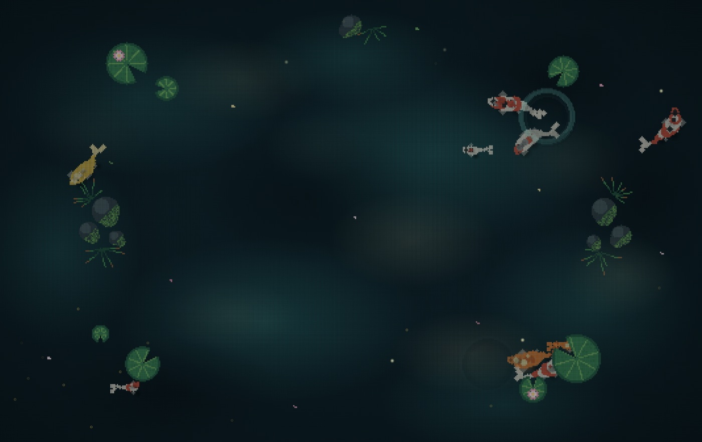
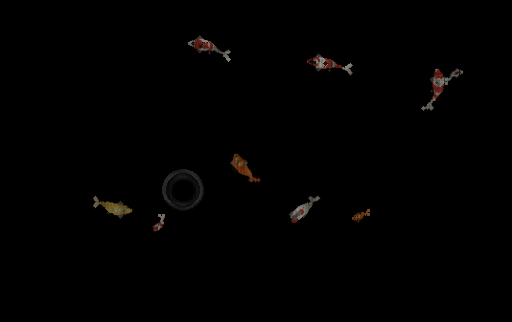

# claude-theme-mods

Theme mods for the Claude desktop and mobile apps. Each theme recolours the app and draws a living pixel scene behind the chat.

## Themes

### koi-pond



A painted pond seen from above. Nine koi, each a chain of small cells, swim looping routes and beat their tails. Now and then one comes up to the surface, and the cells of the grid lift in a ripple where it broke the water. Lily pads, mossy stones and reeds sit over the water, petals blow across, and fireflies come out in dark mode.

Works in dark and light mode, and pauses when the system asks for reduced motion.

### koi-dark



The same koi on plain black: no water, no plants, nothing else. They swim, beat their tails and brighten now and then, and the cells of the grid lift in a grey ripple where one came up. The app's own surfaces go near-black with an orange accent. Made for dark mode only.

## Install

In a Claude Code session, type:

```
/plugin install koi-pond --marketplace lmlong-huynh/claude-theme-mods
```

Put `koi-dark` in place of `koi-pond` for the dark one. Turn on one theme at a time: each sets the whole look, so the last one loaded wins.

Answer `y` to add the marketplace, pick a scope, then restart the app. The scene shows in the Claude desktop and mobile apps; the terminal and editors draw no themes.

## How a theme is built

A theme is one folder under `themes/`:

```
themes/<name>/
  .claude-plugin/plugin.json   name, version, description
  hooks/hooks.json             names the hooks module
  hooks/register.tsx           sets the colours and draws the scene
  hooks/scene.ts               builds the scene as one SVG string
  hooks/make-colors.js         the app's own colour maker, copied in unchanged
```

`register.tsx` sends the look with `$.theme.set` and answers the app's `Backdrop` render with the SVG. The scene runs no script: everything that moves is CSS animation inside the SVG's own `<style>`. The app allows a scene at most 131,072 characters.

Two things the koi pond does that a new theme can reuse:

- **Drawn for a moment in time.** `pond(t)` starts every animation as far into its loop as it would be `t` seconds along. `register.tsx` sends the scene again every minute for the current time, so a frame the app has frozen starts moving again without anything jumping.
- **Cells as strokes.** Shapes are rows of cells drawn as strokes one cell thick, with the grid laid over the top to cut them into cells. That keeps a detailed scene well inside the size limit.

## Adding a theme

1. Copy `themes/koi-pond` to `themes/<name>` and change the `name` in its `plugin.json`.
2. Give the scene its own name prefix in `register.tsx` (letters, digits, `_` and `-` only).
3. Add the theme to `.claude-plugin/marketplace.json`.
4. Check it with `claude plugin validate themes/<name>`.

## Licence

MIT, see [LICENSE](LICENSE). One file is not mine to license: `hooks/make-colors.js` and its `.d.ts` in each theme are Anthropic's colour maker from the Claude Code mod toolkit, copied in unchanged as that file's own header instructs.
